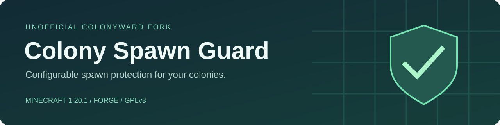

# Colony Spawn Guard

**Unofficial ColonyWard fork · Minecraft 1.20.1 · Forge**

[](https://www.minecraft.net/)
[](https://files.minecraftforge.net/net/minecraftforge/forge/index_1.20.1.html)
[](LICENSE)

[Русский](#русский) · [English](#english) · [Downloads / Скачать](../../releases) · [Report a bug / Ошибка](../../issues)

> Independent, unofficial adaptation of [ColonyWard](https://github.com/EverettSummer/ColonyWard).
> Not affiliated with or endorsed by the original authors, MineColonies, Mojang, or Microsoft.

## Русский

Настраиваемая защита территории MineColonies от появления выбранных мобов. Можно запретить отдельный тип сущности (`minecraft:creeper`) или всех мобов из мода (`alexsmobs`). Правила задаются отдельно для естественного спавна, патрулей, спавнеров и других причин появления.

### Совместимость

| Компонент | Версия |
|---|---|
| Minecraft Java Edition | **1.20.1** |
| Загрузчик | **Forge 47.2.0+**, ветка 47.x |
| Целевая версия MineColonies | **1.20.1-1.1.1301** |
| Structurize в целевой сборке | **1.20.1-1.0.818** |
| Java | **17** |
| Установка | Сервер или одиночная игра |

MineColonies и его обязательные зависимости устанавливаются отдельно. Fabric и NeoForge не поддерживаются. Совместимость с другими версиями MineColonies пока не заявлена.

### Установка

1. Скачайте `colony-spawn-guard-1.20.1-1.0.1.jar` из **Releases**.
2. Положите файл в папку `mods` сервера или нужного профиля одиночной игры.
3. Не устанавливайте одновременно с ColonyWard: оба мода решают одну задачу.
4. Запустите игру или сервер. Настройки появятся в `config/colony_spawn_guard-common.toml`.
5. Отредактируйте списки и перезапустите сервер или игру.

На выделенном сервере клиентам этот мод не требуется. В одиночной игре установите его в свой профиль.

### Настройки

Пример фрагмента автоматически созданного файла (остальные списки оставьте в файле):

```toml
[general]
# Автоматически блокировать враждебных мобов любых модов
blockHostileMobs = true
# Исключения из автоматической блокировки (ID сущности или мода)
hostileExemptions = []
# Запретить естественный спавн криперов и всех мобов мода alexsmobs
natural = ["minecraft:creeper", "alexsmobs"]
# Запретить патрули разбойников
patrol = ["minecraft:pillager", "minecraft:vindicator"]
# Пустой список не накладывает ограничений для этого типа спавна
spawner = []
spawnEgg = []
```

По умолчанию сохранены списки из исходного ColonyWard: ряд ванильных мобов, несколько модов целиком, патрули и отдельные специальные появления. С версии **1.0.1** дополнительно включён автоматический запрет враждебных мобов (`blockHostileMobs = true`): категории `MONSTER` или интерфейса `Enemy`, независимо от мода и списков. Новый параметр автоматически добавляется и в существующий конфиг. Запрет всего пространства имён мода распространяется и на его мирных мобов. Перед игрой проверьте `natural`, особенно если используете Alex's Mobs или Quark.

Списки: `natural`, `chunk_generation`, `spawner`, `structure`, `breeding`, `summoned`, `jockey`, `event`, `conversion`, `reinforcement`, `triggered`, `bucket`, `spawnEgg`, `command`, `dispenser`, `patrol`.

### Границы работы

- Используются границы колонии, определяемые MineColonies.
- Уже существующие мобы не удаляются; пеший вход мобов снаружи не блокируется. Телепортация с добавлением новой сущности может попасть под проверку.
- Мод обрабатывает Forge `PositionCheck`, `FinalizeSpawn` и прямое добавление новых мобов через `EntityJoinLevelEvent`. Загрузка существующих мобов из сохранения не блокируется. Новые сущности с неизвестной причиной спавна также проверяются.
- Команды и яйца спавна исключены из автоматической блокировки, если причина спавна доступна Forge; явные списки `command` и `spawnEgg` всё равно действуют. Мирные мобы не затрагиваются автоматическим режимом. Враждебные мобы, которые мод не пометил как `MONSTER`/`Enemy`, требуют явной записи в списке или отдельной совместимости.
- Рейды MineColonies и нестандартные события других модов требуют отдельной проверки; полное подавление рейдов не заявлено.
- Старые конфиги `colonyward-common.toml` автоматически не переносятся: у форка отдельный mod ID и файл настроек.

## English

Configurable spawn protection inside MineColonies colonies, adapted from ColonyWard for **Minecraft 1.20.1 / Forge**. Block entity IDs or entire mod namespaces, with separate lists per spawn reason.

Install the release JAR on the dedicated server or in your single-player profile. Dedicated-server clients do not need this addon. Requires MineColonies **1.20.1-1.1.1301** and its normal dependencies. Do not install alongside ColonyWard. Configuration: `config/colony_spawn_guard-common.toml`.

Default lists are inherited from upstream and include whole mod namespaces. Review them before use. Existing mobs and mobs entering from outside remain unaffected. Since 1.0.1 automatic hostile blocking is enabled by default (MONSTER category or Enemy interface), including direct insertion into the world. Saved entities are preserved. Known command/spawn-egg reasons are exempt from automatic blocking; explicit reason lists still apply. This is not a tested general raid blocker. See the Russian section above for configuration examples and limitations.

## Build from source

Use JDK 17. MineColonies is a compile-time dependency, not bundled into this JAR. The build downloads the pinned upstream binary from CurseForge and verifies its SHA-256.

```sh
./gradlew build sourcesZip
```

Windows:

```powershell
.\gradlew.bat build sourcesZip
```

To compile against an existing installation instead of the Maven artifact:

```powershell
.\gradlew.bat build '-Pminecolonies_jar=C:\path\to\minecolonies-1.20.1-1.1.1301.jar'
```

Outputs: `build/libs/` and `build/distributions/`. See [CHANGELOG](CHANGELOG.md) and [validation notes](VALIDATION.md).

## Credits and license

Based on [EverettSummer/ColonyWard](https://github.com/EverettSummer/ColonyWard), originally published by **EverettSummer / Box.moe**. Upstream contributions by **mooviies** and **RomDmitriy** are retained and credited. Unofficial 1.20.1 adaptation maintained by **skymr98-alt**.

Distributed under **GNU GPL version 3**; see [LICENSE](LICENSE) and [NOTICE](NOTICE.md). The original project name is used to identify provenance. This fork uses its own name and does not use the original logo. Minecraft and MineColonies names belong to their respective owners.


